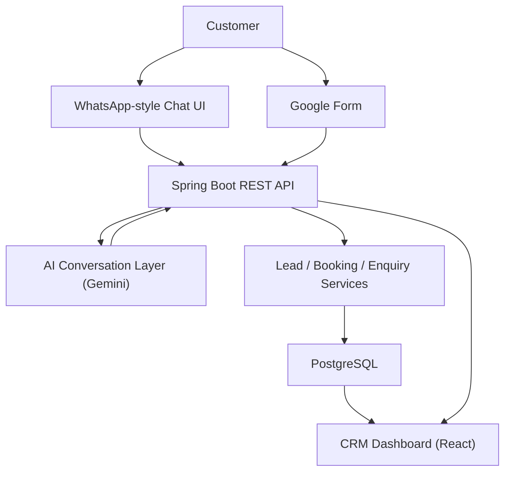
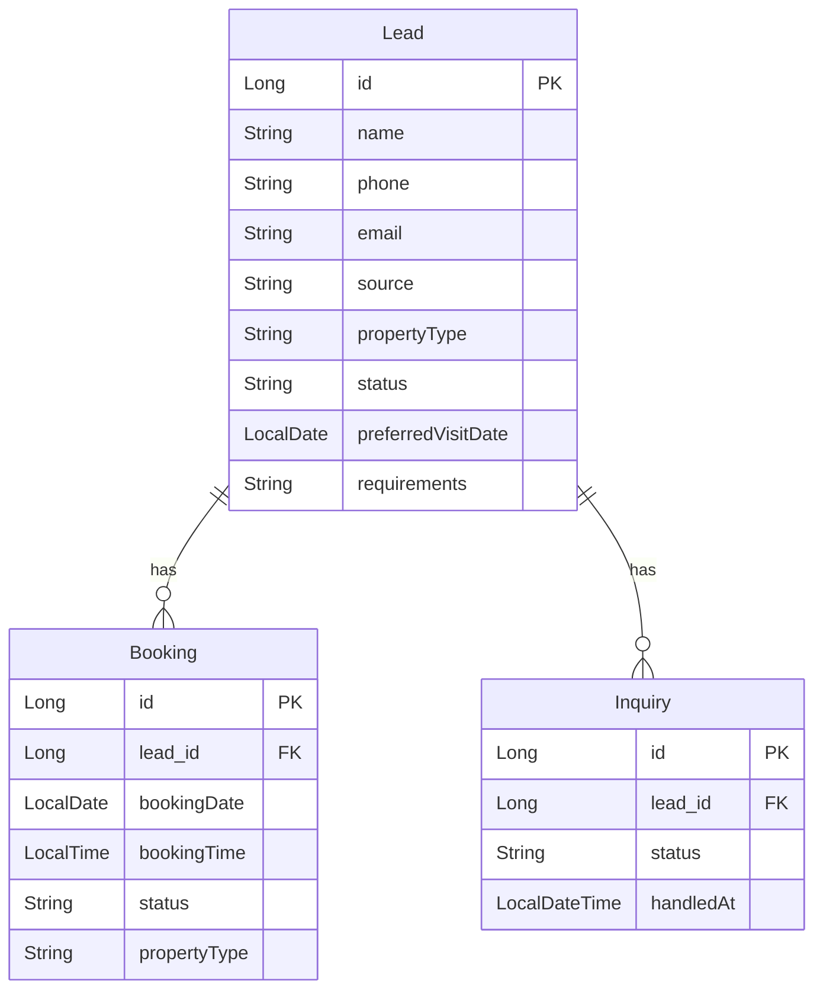

# LeadManager

**LeadManager — AI-powered Lead Management CRM & Sales Automation**

LeadManager is a lead management CRM and sales automation platform that helps businesses capture, qualify, follow up with, and manage customer leads across multiple channels. It demonstrates a full-stack application integrating AI-powered conversations, WhatsApp-style chat automation, Google Forms integration, and a real-time analytics dashboard.

Built as a demonstration using **UrbanNest Realty**, a fictional real-estate business.

---

## Features

- **Lead Management** — Create, track, and manage leads with status tracking, source attribution, property requirements, and search/filtering.
- **Property Visit Booking** — Customers can request property visits with date/time scheduling and booking status management.
- **Enquiry Management** — FIFO call queue for pending enquiries, with contacted/interested/not interested states and enquiry history.
- **AI-Powered Conversations** — Gemini AI interprets natural-language customer messages, extracts structured data (name, phone, email, property type, date, time, requirements), and manages conversational flows.
- **WhatsApp Chat Simulation** — A customer-facing chat UI simulates WhatsApp-style conversations. Customers can enquire about properties, book visits, and provide information naturally. The resulting leads, bookings, and enquiries appear in the admin dashboard.
- **Dashboard & Analytics** — KPI cards (total leads, visits, enquiries, visit rate), lead source breakdown, property demand analysis, lead status pipeline, leads over time chart, recent activity, and upcoming visits.
- **Reports** — Business overview, lead source analytics, property demand, booking performance, enquiry pipeline, and lead status reports.
- **Google Forms Integration** — Google Form submissions create leads. Visit requests create bookings. Other enquiries enter the call queue.

---

## Architecture



**Flow:**
1. Customers interact via the WhatsApp-style chat UI or Google Forms.
2. Messages are sent to the Spring Boot backend REST API.
3. The AI conversation layer (Gemini) interprets natural language and extracts structured information.
4. Business services create and manage leads, bookings, and enquiries in PostgreSQL.
5. The React dashboard displays all data with real-time analytics.

---

## Tech Stack

| Layer | Technology |
|---|---|
| Backend | Java 21, Spring Boot, Spring Data JPA, Hibernate |
| Frontend (Dashboard) | React, Vite, Recharts, Axios |
| Frontend (Chat) | React, Vite, Axios |
| Database | PostgreSQL |
| AI | Google Gemini API (`gemini-2.5-flash`) |
| Build | Maven (backend), npm (frontend) |

---

## Project Structure

```
LeadManager/
├── leadmanager/                    # Spring Boot backend
│   ├── src/main/java/.../
│   │   ├── ai/                    # AI conversation layer (Gemini integration)
│   │   ├── config/                # CORS and application configuration
│   │   ├── controller/            # REST API controllers
│   │   ├── dto/                   # Data transfer objects
│   │   ├── entity/                # JPA entities (Lead, Booking, Inquiry)
│   │   ├── repository/            # Spring Data JPA repositories
│   │   └── service/               # Business logic services
│   ├── src/main/resources/
│   │   └── application.properties # Application configuration
│   └── pom.xml
│
├── leadmanager-frontend/           # React admin dashboard
│   ├── src/
│   │   ├── components/            # Sidebar navigation
│   │   └── pages/                 # Dashboard, Leads, Bookings, Enquiries, Reports
│   ├── package.json
│   └── vite.config.js
│
└── urbannest-chat/                 # WhatsApp-style chat simulation
    ├── src/
    │   └── App.jsx                # Chat interface
    ├── package.json
    └── vite.config.js
```

---

## AI Conversation Flow

LeadManager uses Google Gemini (`gemini-2.5-flash`) to power its AI conversation layer. The flow works as follows:

1. **Customer sends a message** via the chat UI (or WhatsApp webhook).
2. **`WhatsAppService`** validates the input and delegates to `AIConversationService`.
3. **`AIConversationService`** maintains a per-phone `ConversationContext` (in-memory) that tracks collected information across multiple messages.
4. **`GeminiService`** sends the customer message along with conversation context to Gemini with a detailed system prompt. Gemini returns structured JSON containing:
   - `intent` — GREETING, PROPERTY_SEARCH, BOOK_VISIT, INQUIRY, PROVIDE_INFORMATION, etc.
   - `reply` — Natural language response to the customer.
   - Extracted fields: `propertyType`, `name`, `phone`, `email`, `date`, `time`, `requirements`, `wantsVisit`.
5. **`AIConversationService`** merges the extracted information into the conversation context and determines the next action:
   - If booking a visit: progressively collects property type, name, phone, email, date, and time, then creates a Lead and Booking.
   - If making an enquiry: collects information naturally, then creates a Lead and Inquiry.
   - Otherwise: returns the AI-generated reply.

The AI is instructed to behave like a natural, professional property assistant rather than a rigid form. It handles information provided in any order, understands casual language, and adapts to changing customer intent.

---

## WhatsApp Simulation

The `urbannest-chat` frontend is a **simulation/demo** of a WhatsApp-style customer chat interface. It is **not** an integration with the official WhatsApp Business API.

- The chat UI sends messages to `/api/whatsapp/simulator/message`.
- The backend processes messages through the same AI pipeline used for real WhatsApp webhooks.
- Conversations result in leads, bookings, and enquiries that appear in the LeadManager admin dashboard.

The project also includes a `WhatsAppWebhookController` that implements the Meta WhatsApp Cloud API webhook verification and message handling pattern, along with a `WhatsAppCloudService` for sending messages via the Meta Graph API. These components can be connected to a real WhatsApp Business account.

---

## Database

### Entities

**Lead** — Represents a potential customer.
- Fields: `id`, `name`, `phone`, `email`, `source`, `propertyType`, `status`, `preferredVisitDate`, `requirements`, `createdAt`, `lastContactedAt`
- Statuses: `NEW`, `CONTACTED`, `VISIT_BOOKED`, etc.
- Sources: `WHATSAPP`, `GOOGLE_FORM`, etc.

**Booking** — Represents a scheduled property visit.
- Fields: `id`, `lead` (FK), `bookingDate`, `bookingTime`, `status`, `propertyType`, `createdAt`
- Many-to-one relationship with Lead.

**Inquiry** — Represents a customer enquiry in the call queue.
- Fields: `id`, `lead` (FK), `status`, `createdAt`, `handledAt`
- Statuses: `PENDING`, `INTERESTED`, `NOT_INTERESTED`
- Many-to-one relationship with Lead.

### Relationships



---

## API Overview

### Leads — `/api/leads`

| Method | Endpoint | Description |
|---|---|---|
| `GET` | `/api/leads` | Get all leads |
| `GET` | `/api/leads/{id}` | Get lead by ID |
| `POST` | `/api/leads` | Create a new lead |
| `PUT` | `/api/leads/{id}/status?status=` | Update lead status |
| `POST` | `/api/leads/form` | Process a Google Form submission |

### Bookings — `/api/bookings`

| Method | Endpoint | Description |
|---|---|---|
| `GET` | `/api/bookings` | Get all bookings |
| `POST` | `/api/bookings` | Create a new booking |

### Enquiries — `/api/inquiries`

| Method | Endpoint | Description |
|---|---|---|
| `GET` | `/api/inquiries` | Get all enquiries |
| `GET` | `/api/inquiries/queue` | Get pending enquiry call queue (FIFO) |
| `GET` | `/api/inquiries/history` | Get call history (interested/not interested) |
| `PUT` | `/api/inquiries/{id}/status?status=` | Update enquiry status |
| `POST` | `/api/inquiries` | Create a new enquiry |

### Dashboard — `/api/dashboard`

| Method | Endpoint | Description |
|---|---|---|
| `GET` | `/api/dashboard` | Get dashboard KPIs (optional `from`/`to` date params) |

### Analytics — `/api/analytics`

| Method | Endpoint | Description |
|---|---|---|
| `GET` | `/api/analytics` | Get full analytics (optional `from`/`to` date params) |

### WhatsApp Simulator — `/api/whatsapp/simulator`

| Method | Endpoint | Description |
|---|---|---|
| `POST` | `/api/whatsapp/simulator/message` | Send a simulated chat message |
| `POST` | `/api/whatsapp/simulator/reset` | Reset a conversation |

### WhatsApp — `/api/whatsapp`

| Method | Endpoint | Description |
|---|---|---|
| `POST` | `/api/whatsapp/message` | Process an incoming WhatsApp message |
| `POST` | `/api/whatsapp/send-test` | Send a test message via WhatsApp Cloud API |

### WhatsApp Webhook — `/api/whatsapp/webhook`

| Method | Endpoint | Description |
|---|---|---|
| `GET` | `/api/whatsapp/webhook` | Meta webhook verification |
| `POST` | `/api/whatsapp/webhook` | Receive incoming WhatsApp webhook events |

---

## Running Locally

### Prerequisites

- Java 21
- Maven 3.9+
- Node.js 18+ and npm
- PostgreSQL 15+

### 1. Database Setup

```sql
CREATE DATABASE leadmanager;
```

### 2. Environment Variables

Set the following environment variables before starting the backend:

```bash
# Database
export DB_USERNAME=postgres
export DB_PASSWORD=your_database_password

# Gemini AI
export GEMINI_API_KEY=your_gemini_api_key

# WhatsApp Cloud API (optional, only needed for real WhatsApp integration)
export WHATSAPP_VERIFY_TOKEN=your_verify_token
export WHATSAPP_PHONE_NUMBER_ID=your_phone_number_id
export WHATSAPP_ACCESS_TOKEN=your_access_token
```

On Windows (PowerShell):
```powershell
$env:DB_PASSWORD="your_database_password"
$env:GEMINI_API_KEY="your_gemini_api_key"
```

### 3. Start the Backend

```bash
cd leadmanager
./mvnw spring-boot:run
```

The backend runs on `http://localhost:8080`.

### 4. Start the Admin Dashboard

```bash
cd leadmanager-frontend
npm install
npm run dev
```

The dashboard runs on `http://localhost:5173`.

### 5. Start the Chat Simulation

```bash
cd urbannest-chat
npm install
npm run dev
```

The chat UI runs on `http://localhost:5174`.

---

## Environment Variables

| Variable | Description | Required |
|---|---|---|
| `DB_USERNAME` | PostgreSQL username | Yes (defaults to `postgres`) |
| `DB_PASSWORD` | PostgreSQL password | Yes |
| `GEMINI_API_KEY` | Google Gemini API key | Yes |
| `WHATSAPP_VERIFY_TOKEN` | WhatsApp webhook verification token | No (for real WhatsApp only) |
| `WHATSAPP_PHONE_NUMBER_ID` | Meta WhatsApp phone number ID | No (for real WhatsApp only) |
| `WHATSAPP_ACCESS_TOKEN` | Meta WhatsApp Cloud API access token | No (for real WhatsApp only) |

---

## Screenshots

> Screenshots will be added here.

<!--


-->

---

## Future Improvements

- Official WhatsApp Business API integration (replacing the simulation with a production connection)
- Authentication and authorization (user login, role-based access)
- Multi-tenant architecture (support for multiple businesses)
- Cloud-hosted PostgreSQL (managed database for production)
- Production deployment (containerization, CI/CD)
- Persistent AI conversation history (database-backed instead of in-memory)
- Email and SMS notification integrations
- Advanced reporting with export functionality
- Lead assignment and team management
- Customer communication timeline

---

## License

This project is intended for demonstration and portfolio purposes.
